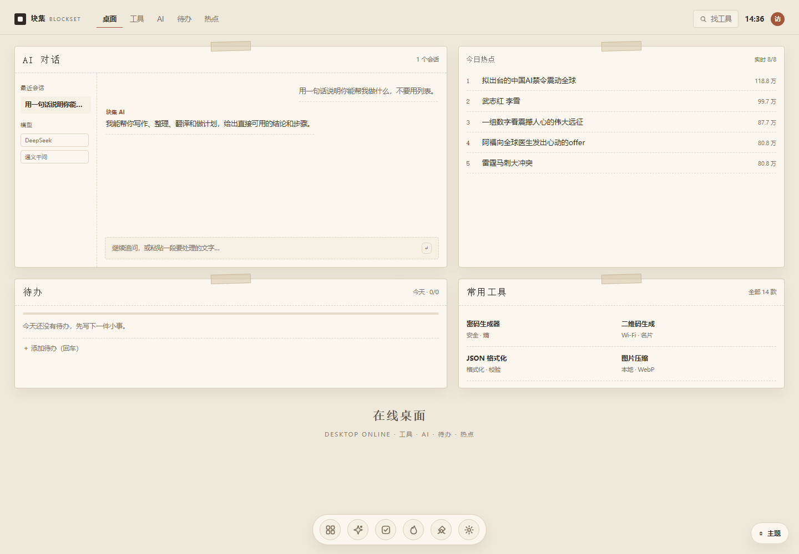
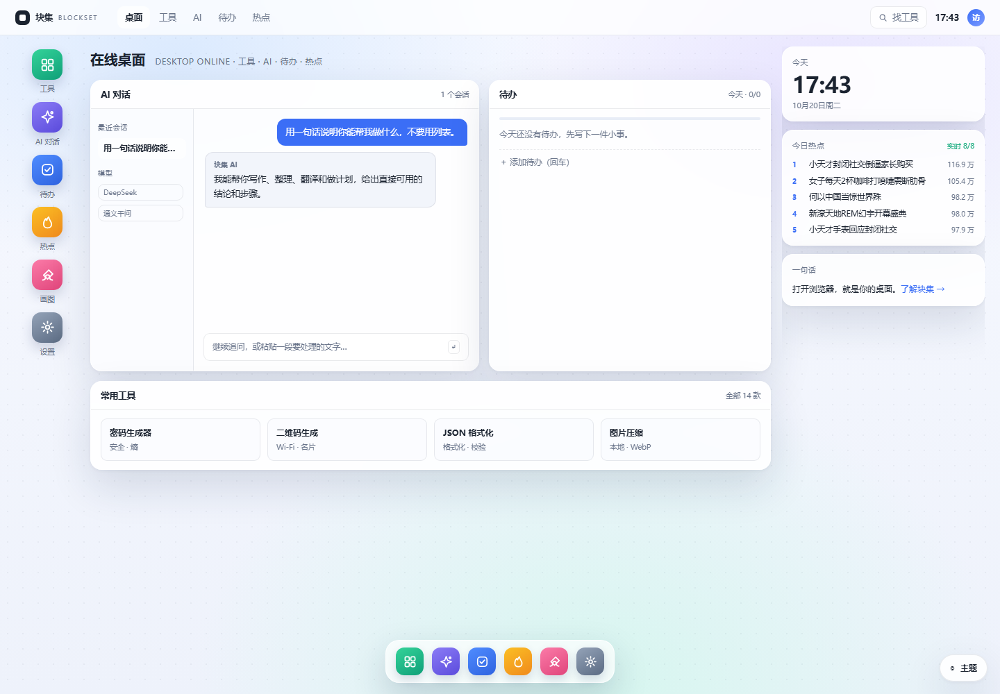
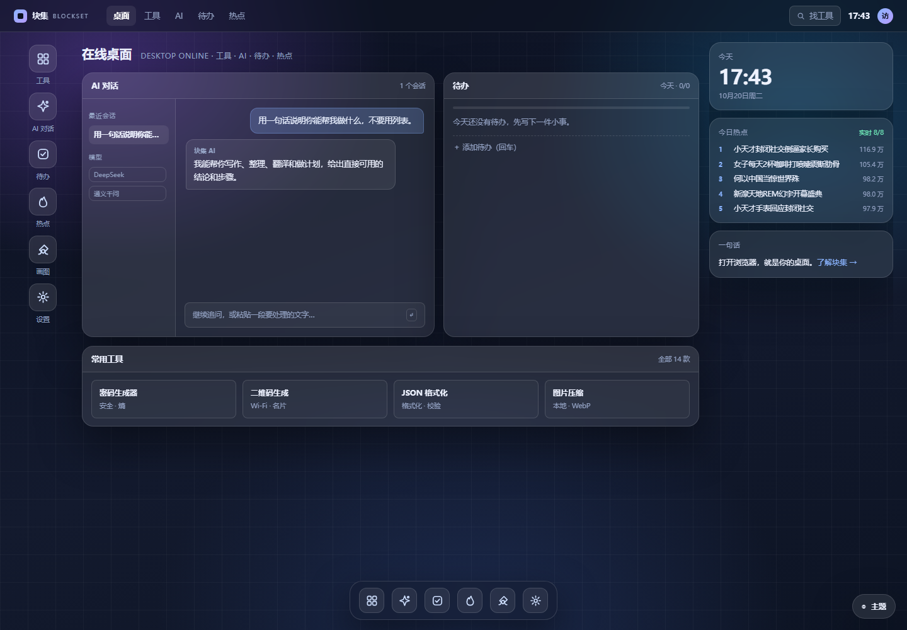
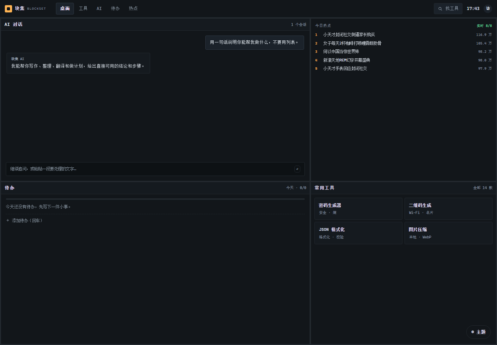
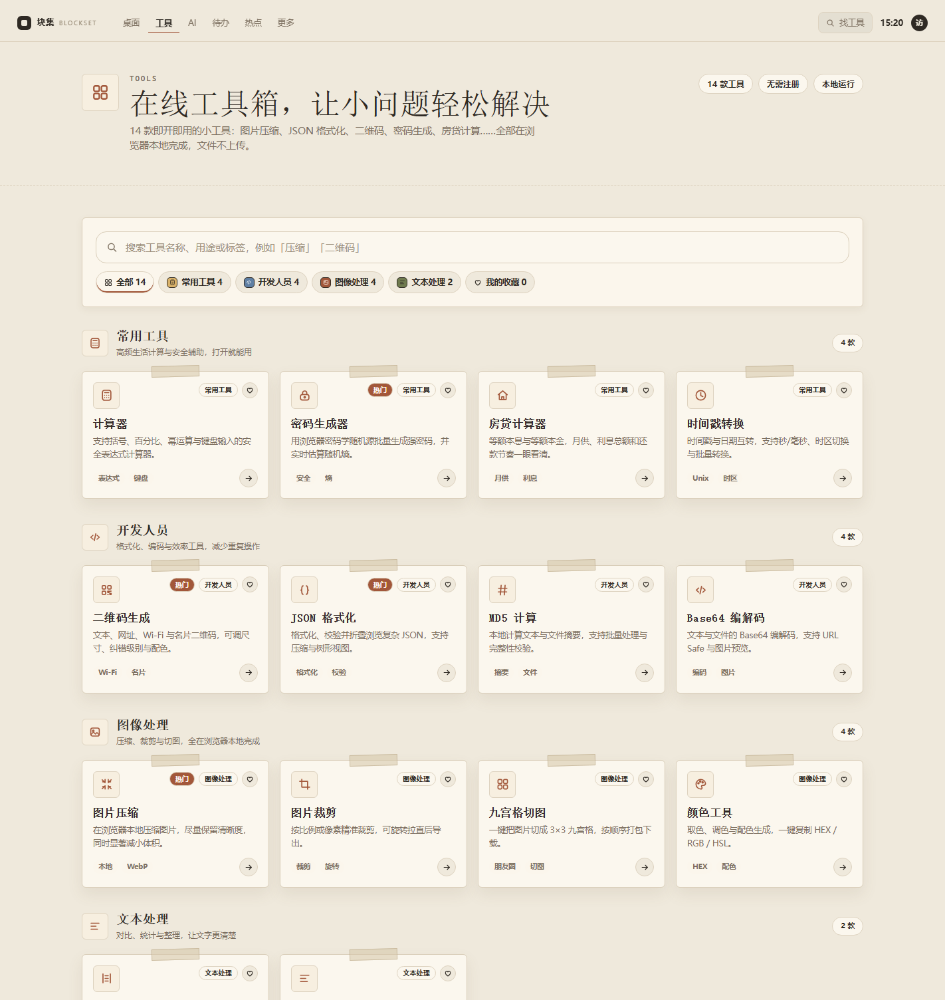
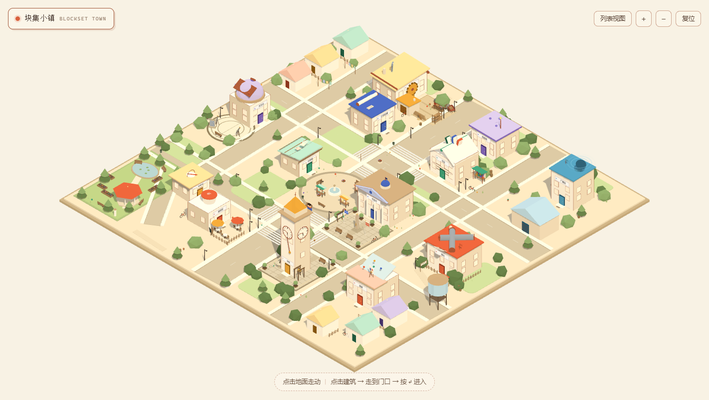
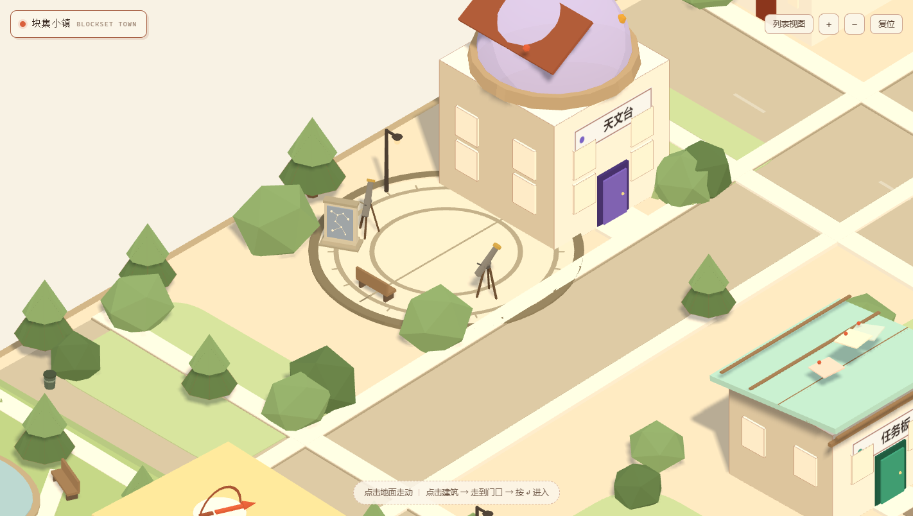

# 块集 BlockSet

> 在线桌面：工具、AI、待办、热点，一屏收好。

一个浏览器里的「在线桌面」：日常工具、可切换模型的 AI 对话（保留历史）、待办规划、聚合热点，都在同一屏完成。
首页是一套可切换的桌面主题（5 套，默认「纸面工作台」）；内页与首页共用同一套设计令牌。
另有一个可以走进去的 **3D 等距小镇**（`/town`）：13 个地点对应 13 个功能板块，走过去按回车就进。

**这是一个原创独立项目**：功能方向参考了常见的工具箱类站点，但代码、文案、视觉、命名全部自研，
与 TTKit 及任何第三方站点没有隶属或合作关系。

---

## 界面预览

| 纸面工作台（默认） | 清爽桌面 |
|---|---|
|  |  |

| 毛玻璃桌面 | 平铺工作台 |
|---|---|
|  |  |

| 设置 · 桌面外观 | 工具箱 |
|---|---|
|  |  |

| 小镇 · 全景 | 小镇 · 天文台观测场 |
|---|---|
|  |  |

完整截图在 `docs/screenshots/`（含移动端、小镇与 5 套主题）。主题机制见 [docs/THEMES.md](docs/THEMES.md)。

## 功能

| 模块 | 内容 |
|---|---|
| **在线桌面** | 首页：应用栏 + 窗口 + Dock + 小组件；5 套主题（清爽/毛玻璃/极简/平铺/纸面）**全站生效**，可切换、记忆、深链 |
| **小镇（3D）** | `/town`：80 × 80 的等距纸模小镇，13 个地点各对应一个功能，其中 8 处已经做成「主楼 + 院落」；正交等距相机、A* 寻路、走到门口按回车进入；WebGL 不可用时降级为建筑列表 |
| 工具箱 | 14 款工具：JSON 格式化、图片压缩、二维码生成、计算器、密码生成、MD5、图片裁剪、房贷计算器、文本对比、字数统计、时间戳转换、Base64、九宫格切图、颜色工具。全部浏览器本地计算，文件不上传 |
| AI 助手 | 对话（流式、多会话、保留历史）、写作（4 种模式）、模型设置（本地保存 Key） |
| 视觉创作 | 文字生图、灵感画廊、我的创作；未配置 Key 时用程序化几何 SVG 演示 |
| 信息聚合 | 8 个平台的每日热点（本地 DailyHotApi 服务 + 3 个原生适配器，实测全部实时）、AI 简报（每天首次打开自动生成，可挂系统定时任务；用 DeepSeek 网页搜索/抓取补权威报道简述）、RSS |
| 个人管理 | 待办清单、完成率与 7 天趋势分析、已安排计划 |
| 内容 | 博客列表/详情、公告、网址导航 |
| 账号 | 匿名即用（IP+UA 派生身份）；可升级为邮箱账号且保留数据 |

所有 AI 能力都有**演示模式**：没有 API Key 时页面完整可用，结果明确标注为演示。

## 3D 小镇（`/town`）

首页是一张「在线桌面」，`/town` 把同一套世界观立起来：一张 80 × 80 的等距纸模地图，
13 个地点各对应一个功能板块。走过去、按回车，就进了那个页面。

**操作**：点地面或建筑 → 人物沿 A* 路径走过去（会绕开建筑、广场与院落里的大件）；
WASD / 方向键直接走；走到门口弹出卡片，按 `↵` 进入；滚轮缩放，右上角复位。

### 一个地点 = 主楼 + 院落

一条贯穿始终的原则：单一建筑撑不起「地点感」。现在 8 处已经是「一整个院子」：

| 地点 | 院落里有什么 |
|---|---|
| **工坊** | 夯土场院、露天工作台（台钳 / 锯 / 锤 / 红色工具箱 / 木凳）、木料堆、料架、手推车、铁砧、会转的砂轮、料棚 |
| **市政厅** | 10 × 9.2 石板广场、路缘石与中轴石带、三级石阶、六棵球树、两面会飘的旗、公告栏、纪念柱、长椅 |
| **钟楼** | 10.2 × 12 钟塔广场、日晷、会摆的钟架、四角球树；钟面按本机时间走针 |
| **天文台** | 直径 8.8 的圆形观测台（环形路缘 / 两道同心环 / 24 道方位刻度 / 子午线）、两架三脚架望远镜、星图石碑 |
| **咖啡馆** | 围栏露台、三张圆桌、两把阳伞、A 字小黑板、花坛 |
| **报社** | 印刷车间、院墙、晾报架、水井、木桶堆 |
| **书店** | 露天书摊、两张长椅、花坛 |
| **电报局** | 夯土院场、两根电线杆与架空电线、蓄电瓶架、发报桌、木箱堆、资费牌 |

其余五处（打字机铺、广播站、地图亭、画室、任务板）目前是单栋楼，
但地块已经按院落的尺度留好了。13 栋主楼各有自己的专属造型与缓慢动画（齿轮转、声波扩散、书页屋顶、望远镜公转……）。

### 技术

- **没有模型文件**：建筑、屋顶、门窗、招牌、院落小品全部由代码程序化生成，首屏不增加任何外部资源体积。
- **材质**：`MeshToonMaterial` + 3 阶渐变贴图；描边用 `EdgesGeometry`，比后处理 OutlinePass 便宜得多。
- **人物**：纸片叠层 + 4 帧行走循环 + 轻微浮动。
- **寻路**：1 米网格 A*，建筑与院落小品各自带碰撞半径（桌椅花坛这类小件可穿过）。
- **动画**：对象创建时打标记（自转 / 浮动 / 公转 / 摆动 / 脉冲），场景初始化时统一收集，每帧推进——不经过 React 重渲染。

### 降级与可访问性

WebGL 不可用或 `prefers-reduced-motion` 时，整页退化为建筑列表（全是真实链接）；
页面同时输出一份 `sr-only` 的建筑导航，搜索引擎和读屏软件读到的是链接而不是 canvas。

设计取舍、平面结构、每个地点的意象来源见 [docs/TOWN.md](docs/TOWN.md)。

## 快速开始

```bash
npm install
cp .env.example .env     # 可选：填 AI Key

# 首次：安装本地热榜聚合服务（DailyHotApi, MIT）
npm run hot:install

# 终端 A：热榜服务（http://127.0.0.1:6688）
npm run hot:start

# 终端 B：站点（http://localhost:4310）
npm run dev
```

> 不启动热榜服务也能跑：热点页会自动回退到内置示例数据，并在界面标注。
> 数据源细节见 [docs/HOT-DATA.md](docs/HOT-DATA.md)；简报原理与每天自动生成见 [docs/BRIEF.md](docs/BRIEF.md)。

生产构建：

```bash
npm run build && npm start
```

类型检查：

```bash
npm run typecheck        # 或 node node_modules/typescript/bin/tsc --noEmit -p tsconfig.json
```

## 环境变量

```ini
# 全部可选。不填 → AI 走演示模式，热点走示例数据
# 建议用 BLOCKSET_AI_* 前缀：宿主机上已有的 OPENAI_* 变量不会串进来
BLOCKSET_AI_KEY=
BLOCKSET_AI_BASE=https://api.deepseek.com/v1
BLOCKSET_AI_MODEL=deepseek-chat
BLOCKSET_AI_IMAGE_MODEL=gpt-image-1

# 兼容写法（BLOCKSET_AI_* 未设置时生效）
# OPENAI_API_KEY=
# OPENAI_BASE_URL=
# OPENAI_MODEL=
# OPENAI_IMAGE_MODEL=

HOT_API_BASE=http://127.0.0.1:6688   # 本地热榜聚合服务；留空 → 示例数据
BRIEF_NEWS=1            # AI 简报「重点新闻」：调用 DeepSeek 网页搜索/抓取（按次计费，0 关闭）
BRIEF_NEWS_MAX=3        # 每次最多几条重点新闻（1-5）
SESSION_SECRET=          # 生产环境务必替换，用于签名登录 cookie
```

## 目录结构

```text
app/
  layout.tsx               根布局（只放 html/body）
  desktop.css              在线桌面结构 + 5 套主题 token
  (desktop)/
    page.tsx               首页：在线桌面（按 cookie / ?theme= 选主题）
    layout.tsx             只引入 desktop.css
  (site)/                  其余页面：共用 Header + Footer
    layout.tsx
    apps/ ai/ drawing/ daily-hot/ daily-brief/ article/ announcements/
    menus/ user/ auth/ scheduled-tasks/ settings/ about/ support/
  town/                    小镇：3D 等距场景页（独立 HUD，不带 Header）
    page.tsx               路由 + 供搜索引擎与读屏用的建筑导航
    town.css               纸面 HUD 样式
  api/                     ai / hot / brief / todo / schedule / auth / favorites / theme
components/
  desktop/                 主题切换器、桌面时钟
  town/                    小镇 React 封装、进入卡片与列表降级
  site/                    Header / Footer
  ui/                      分区标题、页头、空状态、统计块
  user/                    设置页、外观面板
  tool-card.tsx            工具卡片
  icons.tsx                全站手写 SVG 图标 + Logo
lib/
  theme.ts                 主题注册表 + cookie 名 + 校验
  town/                    小镇（见 docs/TOWN.md）
    data.ts                唯一事实来源：街道、13 个地点、院落附属、配景点位、色板
    build.ts               建筑外壳、门窗户、街道、公园、装饰建筑
    signature.ts           13 栋各自的专属造型与缓慢动画
    site.ts                院落附属构件（工作台、砂轮、广场铺装、日晷、圆形观测台……）
    materials.ts           共享卡通材质、描边、动画标记
    props.ts               生活小品：灌木、篱笆、自行车、木箱、晾衣绳……
    textures.ts            招牌 / 钟面 / 布告的 Canvas 程序化贴图
    path.ts                1 米网格 A*
    scene.ts               渲染器、等距相机、光照、交互与每帧动画
  db.ts                    SQLite 单例 + 建表
  auth.ts                  匿名身份 / 密码 / 签名会话
  site.ts                  导航与工具注册表（唯一事实来源）
  articles.ts              博客 Markdown 读取与渲染
  hot.ts                   热榜类型、示例数据、缓存读写
  hot-fetch.ts             热榜调度：原生适配器 → 本地聚合服务 → 缓存 → 示例
  hot-native.ts            原生适配器（weibo / baidu / github）
content/articles/          博客 Markdown
vendor/hot-service/        本地热榜聚合服务（DailyHotApi, MIT）
data → .data/blockset.db   运行时生成的 SQLite 文件（已 gitignore）
docs/
  CONVENTIONS.md           设计与编码约定
  THEMES.md                桌面主题机制与新增主题步骤
  TOWN.md                  3D 小镇的设计方向、建筑映射与实现要点
  HOT-DATA.md              热榜数据源架构与接入说明
  RISK.md                  上线前合规与风险清单
```

## 数据与隐私

- 工具计算全部在浏览器本地完成，**不产生任何上传**。
- 待办、会话、创作记录存在 `.data/blockset.db`（本机单文件 SQLite）。
- 匿名身份由 `sha256(IP + User-Agent)` 派生，不含任何个人信息；登录后才写入邮箱。
- 未配置 AI Key 时不会向任何外部服务发送内容。

## 部署

1. 换掉 `SESSION_SECRET`；
2. 数据目录 `.data/` 需要持久化卷；
3. 反向代理到 4310，开启 gzip/brotli；
4. 对外提供生成式 AI 功能前，先读 `docs/RISK.md`。

## 已知限制

- 主题是全站生效的：首页桌面用独立的 `--d-*` token，内页通过覆盖 Tailwind `--color-*` 与 `--ds-*` 令牌换肤。
- 主题切换依赖 cookie，根布局读取 cookie 后所有页面动态渲染；纯静态导出（`output: export`）不适用。
- 热榜靠上游公开接口，平台风控变化时个别来源会回退到示例数据（有标注，不影响整页）；V2EX 在本机不可达，已换成掘金。
- 演示模式的热点与 AI 内容是预置示例，不能当真实数据用。
- 「已安排」只做计划清单与到期高亮，没有常驻后台进程执行任务。
- 匿名身份绑定 IP+UA，换网络或换浏览器会被视为新访客（正式产品应改为 cookie 设备 id）。
- 图片压缩走 Canvas，超大图（>20MP）在移动端可能内存不足。
- 小镇是独立的视觉层：固定俯角与固定朝向（不能自由旋转，避免在等距投影下迷向），固定日间纸模、暂不跟随 5 套主题变色；建筑内部没有二级菜单，点击直接跳转；13 个地点里仍有 5 处是单栋楼；地图整体一次性构建，没有分块或按需加载；首次进入要下载 3D 引擎（约 160 KB gzip）。

## 开发脚本

```bash
npm run dev            # 开发服务器（端口 4310）
npm run dev:clean      # 清掉 .next 后重启（样式/编译缓存异常时用）
npm run hot:install    # 首次安装本地热榜聚合服务依赖
npm run hot:start      # 启动热榜聚合服务（端口 6688）
npm run typecheck      # tsc --noEmit
npm run db:reset       # 清空本地 SQLite 演示数据
node scripts/smoke.mjs # 逐路由冒烟测试（默认 http://127.0.0.1:4310）
node scripts/cdp-theme.mjs   # 真实浏览器验证主题切换（data-theme / localStorage / cookie）
npm run brief:gen             # 手动生成一期 AI 简报（每天自动生成见 docs/BRIEF.md）
npm run brief:task            # 注册 Windows 每日计划任务（08:00）
node scripts/cdp-shot.mjs /apps/json-reader   # 用本机 Chrome 截图 + 抓控制台错误
node scripts/town-check.mjs                  # 验证小镇：渲染、控制台错误、走到门口，并输出全景/门口/特写三张图
node scripts/cdp-audit.mjs / /apps            # 移动端横向溢出审计
```

> 迁移到新机器时：先 `npm install`，再 `npm run dev`。如果 HMR 提示跨源拦截，
> 检查 `next.config.ts` 里的 `allowedDevOrigins` 是否包含你访问用的主机名。

## 路线图

- [ ] 工具参数可分享链接、工具收藏同步
- [ ] AI 简报支持自定义关注领域
- [ ] 待办支持子任务与标签
- [ ] 全站 PWA 离线缓存
- [ ] 接入真实热榜数据源（需处理来源合规）
- [ ] 小镇：其余 5 个地点补院落（打字机铺、广播站、地图亭、画室、任务板）
- [ ] 小镇：夜间霓虹版（跟随深色主题换光照与配色）
- [ ] 小镇：建筑内部二级菜单（画室进去先选「创建 / 画廊 / 我的创作」）
